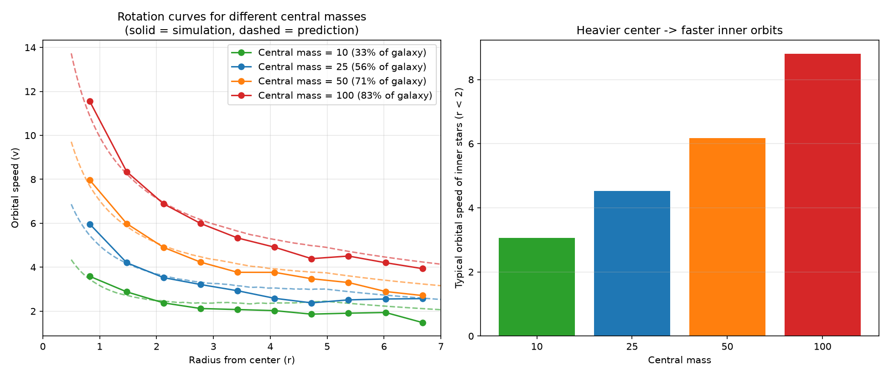
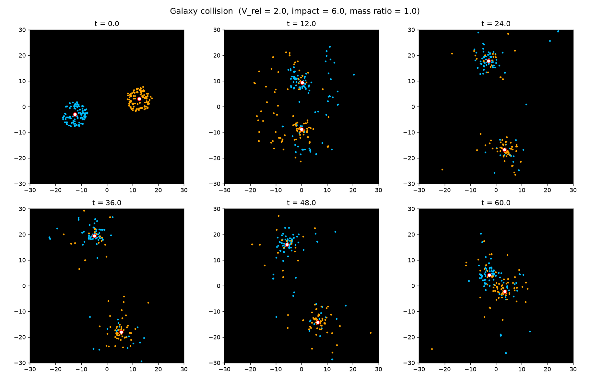
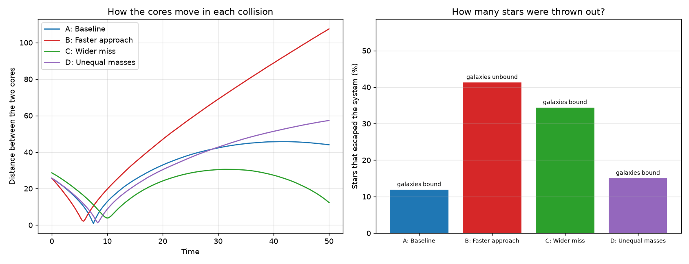
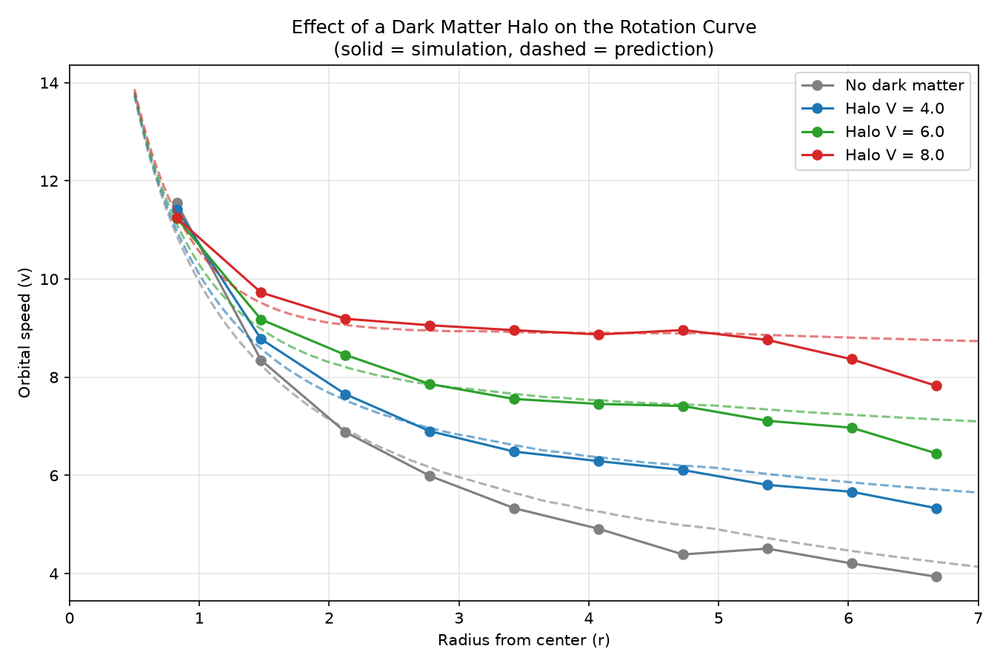
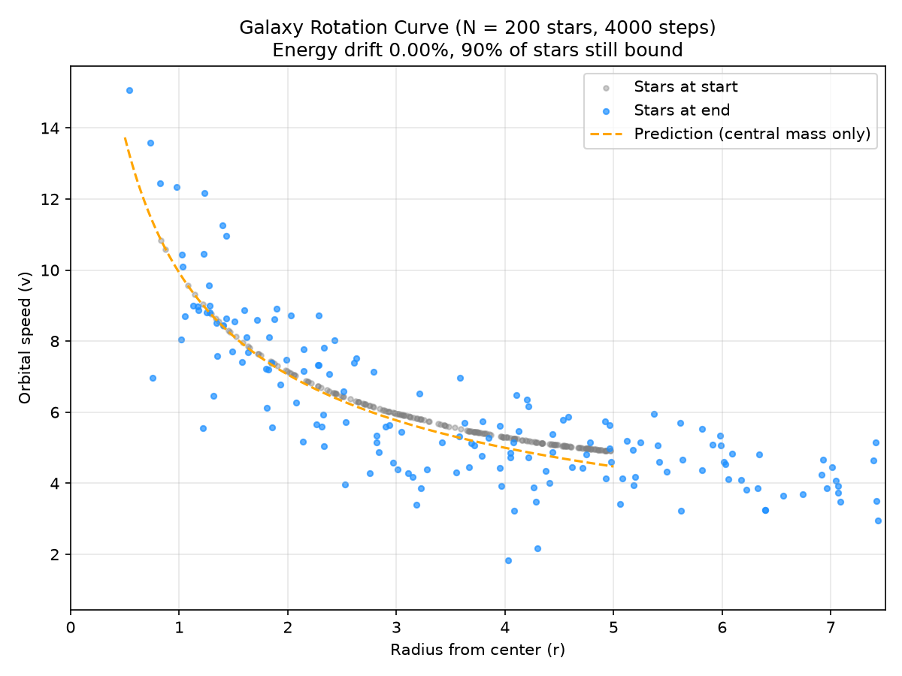
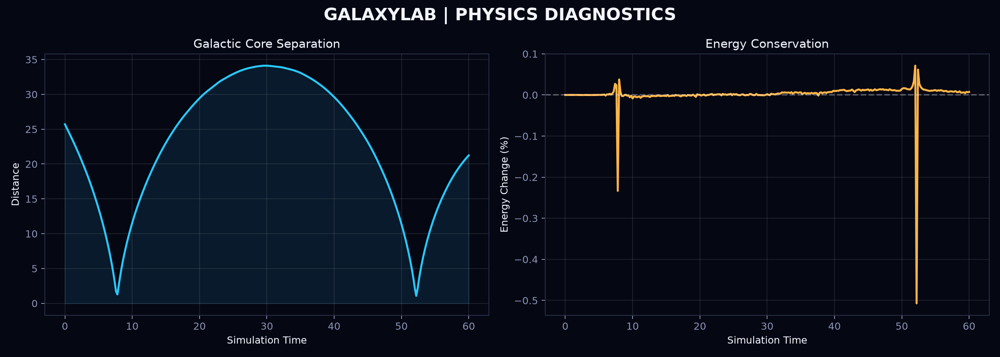

#🌌Galaxy Lab
### Exploring the Universe Through Python and Computational Physics
Galaxy Lab is an interactive Python-based astrophysics project focused on exploring galaxy dynamics, gravitational interactions, dark matter and numerical simulations.
The project uses computational methods and visual simulations to understand some of the fundamental processes that govern galaxies and celestial systems.
##🎯 Project Modules
| Module | Description |
|---|---|
|`central_mass.py` | Central mass simulation |
| `two_body_sim.py` | Two-body gravitational simulation |
| `galaxy_nbody_sim.py` | Galaxy N-body simulation |
| `collision.py` | Galaxy collision simulation |
| `collision_experiments.py` | Collision experiments |
| `dark_matter.py` | Dark matter modelling |
| `rotation_curve.py` | Galactic rotation curve analysis |
| `scaling.py` | Computational scaling experiments |

## 🪐 Simulation Gallery

### 1. Central Mass Experiment

### 2. Galaxy Collision

### 3. Collision Comparison

### 4. Dark Matter Curves

### 5. Galactic Rotation Curve

### 6. Collision Physics Dashboard

## 🧪 Physics Concepts Explored 
- Newtonian Gravitation
- Two-body dynamics
- N-body simulations
- Galaxy collisions
- Dark matter modelling
- Galactic rotation curves
- Numerical and computational methods

## 💻 Technologies

- Python
- Scientific computing
- Numerical simulation
- Data visualization

## 🚀 Getting Started

1. Clone this repository:

   `git clone https://github.com/chhavisangwan49-byte/Galaxy-Lab.git`

2. Open the project folder:

   `cd Galaxy-Lab`

3. Install the Python libraries required by the individual scripts.

4. Run a simulation:

   `python galaxy_nbody_sim.py`

   You can also explore the other Python scripts independently.

## 🔬 Future Improvements

- Improve numerical accuracy and simulation performance.
- Explore more realistic galaxy interaction models.
- Expand dark matter modelling.
- Add more interactive visualizations.
- Compare simulation results with astrophysical observations.
## 👩‍🚀 About This Project

Galaxy Lab is an ongoing learning and computational astrophysics project developed to explore the fascinating connection between physics, mathematics and programming.

**Exploring the cosmos, one simulation at a time.** ✨

---

**License:** MIT
